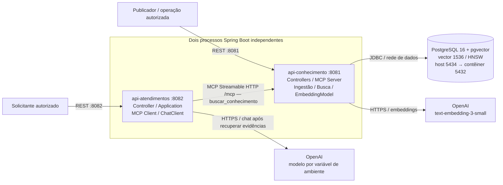
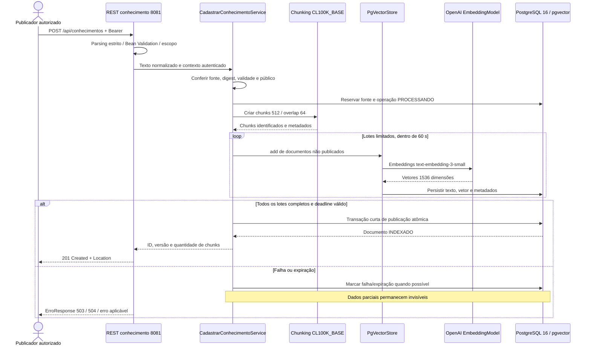
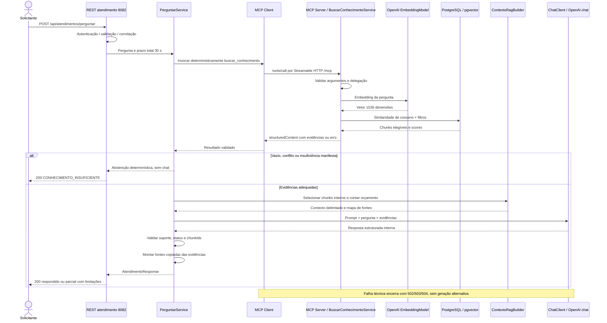

# Arquitetura do MVP — COTI AI Atendimento

## 1. Status, referências e limites

Esta é a arquitetura de referência definitiva para implementar o MVP especificado em `specs/02-requirements.md` e contratado em `specs/06-api-contracts.md`, subordinada a `specs/01-constitution.md` e `AGENTS.md`. “Definitiva” significa decisões explícitas e controladas por revisão; não significa que integração, qualidade de recuperação ou segurança já foram comprovadas por execução.

Foram lidas integralmente essas especificações e as quatro skills em `skills/`. O caminho `specs/r02-equirements.md` informado na solicitação original não existe; o documento de requisitos utilizado é `specs/02-requirements.md`. Nenhum arquivo foi renomeado. A T001 corrigiu explicitamente a referência da constituição para `specs/06-api-contracts.md`, o contrato canônico, e registrou RC01–RC03 para as operações administrativas já previstas. Essa reconciliação não altera as decisões técnicas desta arquitetura.

O MVP inclui cadastro textual síncrono, chunking com sobreposição, embeddings, pesquisa semântica, tool MCP e atendimento REST contextualizado. Inclui também as consultas administrativas e o diagnóstico explicitamente solicitados e formalizados no contrato. Não inclui interfaces visuais, ingestão de binários, crawler, atualização/exclusão pública de documentos, memória conversacional, filas, retries automáticos, execução de ações comerciais ou novas tools.

Este arquivo descreve componentes, fluxos e estrutura futura; não cria POMs, Dockerfiles, configurações executáveis, migrações ou classes.

## 2. Stack e versões de referência

| Componente | Decisão |
|---|---|
| Java | Java 21, compilação com release 21; JDK para build e JRE 21 para execução. |
| Build | Maven Wrapper, distribuição Maven 3.9.11; monorepo com agregador e dois módulos executáveis. |
| Spring Boot | **4.1.1**, fixado no parent; não usar versões dinâmicas nem atualizar implicitamente para outro patch. |
| Spring AI | **2.0.1**, módulos alinhados por `spring-ai-bom`. |
| Spring Framework/Security/JDBC/Jackson/Flyway/Mockito | Versões gerenciadas pelo BOM de Boot 4.1.1, salvo exceções explícitas desta arquitetura. |
| Web | Spring MVC/Servlet nos dois serviços, execução síncrona e bloqueante com prazos limitados. |
| PostgreSQL | Major **16**, em Docker Desktop, imagem **`pgvector/pgvector:0.8.2-pg16-bookworm`**. |
| pgvector | **0.8.2**, coluna `vector(1536)`, cosseno e HNSW. Registrar digest da imagem resolvida no preparo da infraestrutura. |
| Embeddings | OpenAI `text-embedding-3-small`, **1536 dimensões**, exclusivamente em conhecimento. |
| Tokenização da ingestão | CL100K_BASE, identificador e versão da biblioteca registrados no build. |
| Chat | OpenAI por Spring AI ChatClient; `OPENAI_CHAT_MODEL` obrigatório, sem modelo implícito de fallback. |
| MCP | Streamable HTTP; SDK **2.0.0**, alinhado à versão referenciada pelo Spring AI 2.0.1, sem override isolado. |
| Protocolo MCP | Revisão alvo **2025-06-18**, com teste de negociação e structuredContent. Não alegar que a revisão foi testada nesta etapa. |
| OpenAPI | `springdoc-openapi-starter-webmvc-ui` **3.1.1**, documentação REST; não habilitar módulos springdoc que convertam endpoints REST em tools. |
| Testes | JUnit Jupiter **5.14.0** por `junit-bom`, Mockito gerenciado pelo Boot; integração sem SpringExtension, conforme seção 15. |
| Testcontainers | Versão do BOM Boot 4.1.1, API core/PostgreSQL com ciclo de vida explícito, sem extensão JUnit. |
| Plugins de teste | Maven Surefire e Failsafe **3.5.4**, configurados para separar `*Test` e `*IT`. |

A documentação do Spring AI declara suporte a Boot 4.0.x e 4.1.x. A seleção de **4.1.1** também acompanha a versão usada no [POM oficial do Spring AI 2.0.1](https://raw.githubusercontent.com/spring-projects/spring-ai/v2.0.1/pom.xml), que registra SDK MCP 2.0.0. Isso fundamenta a seleção, sem substituir o futuro build integrado. Ver [compatibilidade Spring AI](https://docs.spring.io/spring-ai/reference/getting-started.html).

O [POM do springdoc 3.1.1](https://raw.githubusercontent.com/springdoc/springdoc-openapi/v3.1.1/pom.xml) utiliza Boot 4.1.0; adotar essa linha com Boot 4.1.1 e validar geração/OpenAPI no build. O [pgvector 0.8.2](https://github.com/pgvector/pgvector/tree/v0.8.2) documenta a imagem para PostgreSQL 16. Não usar a tag flutuante `latest`.

O patch efetivo do PostgreSQL fornecido pela imagem e seu digest devem ser registrados ao preparar Docker, sem inventar um digest nesta especificação. Atualizações de segurança de qualquer versão exigem revisão e repetição dos testes afetados.

## 3. Monorepo Maven e independência

- Coordenadas do projeto: grupo `br.com.cotiinformatica`, agregador `coti-ai-atendimento`, versão inicial `0.0.1-SNAPSHOT`, packaging `pom`.
- Root POM como parent de build, com Boot 4.1.1, BOM Spring AI 2.0.1, configuração Java 21, plugins e módulos `api-conhecimento` e `api-atendimentos`.
- Cada módulo tem POM, classe principal, configuração, testes, JAR Spring Boot e imagem próprios. Não existe dependência Maven entre os dois executáveis e não existe módulo Java compartilhado de domínio, entidades ou repositórios.
- Configuração de dependências no parent usa dependencyManagement; drivers e starters de conhecimento não entram em dependencies herdadas por atendimento.
- Reutilização entre serviços ocorre pelo contrato de rede, não por biblioteca de pesquisa compartilhada. DTOs de fronteira são independentes em cada consumidor/produtor, validados contra o contrato.
- Cada projeto pode ser construído com seu POM a partir do checkout, sem compilar o outro serviço. O parent continua necessário como fonte de configuração de build, mas não é uma dependência de runtime.
- Maven Central para releases; sem repositórios snapshot/milestone por padrão. Conferir effective-pom e dependency:tree antes de aceitar o primeiro build.

## 4. Topologia, portas e isolamento

| Serviço | Host de desenvolvimento | Dentro do Compose | Responsabilidade |
|---|---|---|---|
| api-conhecimento | `127.0.0.1:8081` | `api-conhecimento:8081` | REST administrativo, MCP, ingestão, embeddings e persistência. |
| api-atendimentos | `127.0.0.1:8082` | `api-atendimentos:8082` | REST do aluno, cliente MCP e geração de resposta. |
| PostgreSQL/pgvector | `127.0.0.1:5434` | `postgres:5432` | Dados exclusivos de conhecimento. |

URLs locais: conhecimento em `http://localhost:8081`, MCP em `http://localhost:8081/mcp`, atendimento em `http://localhost:8082`. JDBC local de conhecimento: `jdbc:postgresql://localhost:5434/coti_conhecimento`. Em contêineres, JDBC usa `postgres:5432` e MCP usa `http://api-conhecimento:8081/mcp`; `localhost` dentro de um contêiner não identifica outro contêiner.

O Docker Compose terá redes `servicos`, `dados` e `operacao_local`: ambos os aplicativos em `servicos`; apenas conhecimento e PostgreSQL em `dados`, que é interna. PostgreSQL participa também de `operacao_local`, uma bridge exclusiva do banco para viabilizar a porta administrativa local; nenhum aplicativo participa dela. Desabilitar masquerade de saída nessa bridge. Conhecimento tem saída HTTPS para embeddings; atendimento tem saída HTTPS para chat. PostgreSQL não precisa de acesso à internet. O mapeamento de 5434 é somente loopback para operação local; não expor o banco na rede externa.

**Adaptação necessária da fase 1 (ADR-13):** a validação no Docker Desktop 4.61.0/Engine 29.2.1 demonstrou que PostgreSQL conectado somente à bridge interna permanece saudável, mas não recebe o mapeamento efetivo da porta e localhost:5434 recusa conexão. A bridge exclusiva de operação local resolve esse requisito sem conectar o banco à rede `servicos` ou conceder acesso ao atendimento. Verificar o mapeamento efetivo e uma conexão TCP, não apenas o YAML. Esta configuração é para desenvolvimento; remover a publicação e a bridge de operação antes de expor em rede. Referências: [redes Compose](https://docs.docker.com/compose/how-tos/networking/) e [publicação de portas](https://docs.docker.com/engine/network/port-publishing/).

No perfil JVM local, definir `server.address=127.0.0.1`. No perfil contêiner, escutar na interface do contêiner e publicar as portas no host com bind em `127.0.0.1`, evitando confundir bind interno com exposição externa. Somente conhecimento recebe variáveis JDBC. Atendimento não possui credencial de banco nem conectividade na rede `dados`.



Não existe aresta de atendimento ao banco no desenho ou na implementação. A rota REST de diagnóstico não é utilizada pelo cliente MCP.

## 5. Camadas e dependências internas

Pacotes base: `br.com.cotiinformatica.conhecimento` e `br.com.cotiinformatica.atendimentos`. Não organizar ambos como um único contexto Spring.

| Camada/pacote | Responsabilidade | Limites |
|---|---|---|
| `controller` e `controller.dto` | Rotas REST, entrada/saída HTTP, records, Bean Validation, mapeamento de erros. | Sem JDBC, chunking ou lógica de prompt. |
| `application.service` | Casos de uso, sequência de operações, prazo total, transações locais e coordenação de validações. | Conhece portas e domínio; não depende do controller nem de SDK MCP/OpenAI. |
| `application.port` | Contratos internos de persistência, recuperação, geração, tokenização e política de fontes. | Tipos próprios, sem entidades do outro serviço ou contratos do SDK no domínio. |
| `domain.model` e `domain.policy` | Documento, versão, chunk, evidência, resultado, invariantes de elegibilidade e suficiência. | Sem detalhes de HTTP/JDBC/SDK; usar objetos imutáveis. |
| `infrastructure.persistence` | JDBC, repositórios, transações e adaptação PgVectorStore, somente conhecimento. | Não expor SQL ou entidades aos clientes. |
| `infrastructure.mcp` | Adaptador servidor em conhecimento, adaptador cliente em atendimento. | Conhece protocolo, schemas e erros; delega casos de uso. |
| `infrastructure.ai` | EmbeddingModel em conhecimento, ChatClient em atendimento, serialização e tokenizadores. | Não decide permissões nem inventa fontes. |
| `infrastructure.security` | JWT, escopos, contexto delegado e mapeamento das falhas de segurança. | Não confiar em argumentos da tool ou texto como identidade. |
| `infrastructure.config` e `infrastructure.observability` | Beans, propriedades validadas, clocks, prazos, logging e tracing. | Configuração externa; sem credenciais em código. |

Controllers/adaptadores de entrada → application → domain/ports. Adaptadores de infraestrutura implementam portas; configuration conecta implementações. Anotações de serviço/transação podem ficar na aplicação; o modelo de domínio não depende de Spring AI.

Injeção por construtor e campos finais. Records para DTOs de REST, MCP e saída estruturada interna. Não introduzir Lombok, JPA, frameworks de mapeamento ou abstrações genéricas de repositório sem necessidade do MVP.

### 5.1 Bean Validation e parsing

Usar Jakarta Bean Validation: `@NotBlank`, `@NotNull`, `@Min`, `@Max`, `@Valid` e validadores de regras cruzadas. O contrato conta **pontos de código Unicode**, portanto `@Size` isolado sobre String não garante o limite contratado; complementar com validador específico após NFC e trim apropriado. Validar datas, enums, UUIDs, limite e invariantes também no caso de uso MCP.

Desabilitar coerções permissivas e detectar chaves JSON duplicadas/propriedades desconhecidas. Usar a configuração Jackson gerenciada pelo Boot 4; não copiar imports/configurações antigas de Jackson 2 indiscriminadamente. Validar primeiro os bytes do corpo, depois dados, antes de chamadas externas. A sobrecarga de serialização e os erros de parsing devem respeitar o envelope contratado.

## 6. Componentes de cada microsserviço

### 6.1 api-conhecimento

- **ConhecimentoController:** POST/GET coleção e GET por UUID, conforme contrato.
- **DiagnosticoConhecimentoController:** POST de diagnóstico protegido por escopo próprio, negado à identidade do atendimento.
- **CadastrarConhecimentoService:** aprovação de fonte, deduplicação, operação de ingestão, chunking, indexação e publicação.
- **ConsultarConhecimentoService:** consulta/listagem com autorização antes de contagem/paginação.
- **BuscarConhecimentoService:** caso de uso único de recuperação, chamado pelo adaptador MCP e pelo diagnóstico administrativo.
- **ChunkingService:** transformação textual por janelas de tokens com sobreposição explícita.
- **PoliticaFontesAdapter:** registro administrativo confiável de aprovação, integridade, validade e público de fontes.
- **PgVectorKnowledgeAdapter:** VectorStore/PgVectorStore, schema, metadados, filtros e scores; repositórios JDBC de documentos/operações.
- **ConhecimentoMcpServerAdapter:** registro da tool exata com inputSchema/outputSchema, validação e retorno estruturado; não elabora respostas de chat.
- **OpenAiEmbeddingModel:** produz vetores tanto dos chunks quanto das perguntas; modelo de chat desabilitado neste serviço.

Dependências principais: MVC, Validation, Security Resource Server/Jose, Actuator, Micrometer, springdoc webmvc, `spring-ai-starter-model-openai`, `spring-ai-starter-vector-store-pgvector`, `spring-ai-starter-mcp-server-webmvc`, JDBC, driver PostgreSQL e integração Flyway/PostgreSQL. Somente este serviço contém os starters/driver de persistência.

### 6.2 api-atendimentos

- **AtendimentoController:** recebe apenas pergunta, expõe resultado/erro e identificação da requisição.
- **PerguntarService:** consulta MCP de forma determinística, valida evidências, constrói contexto, chama geração e valida resposta.
- **ConhecimentoMcpClientAdapter:** inicialização, descoberta de `buscar_conhecimento`, chamada, validação e tradução de falhas do protocolo.
- **ContextoRagBuilder:** seleciona chunks inteiros por relevância sob orçamento, sem alterar texto nem remover condições essenciais.
- **PoliticaResposta/ValidadorResposta:** insuficiência, conflitos, referências e invariantes de status/fontes/limitações.
- **OpenAiRespostaAdapter:** ChatClient e resposta estruturada; não recebe credenciais do banco e não faz busca por advisor vetorial.
- **MontadorFontes:** copia metadados das evidências efetivamente utilizadas; não aceita fontes criadas pelo LLM.

Dependências principais: MVC, Validation, Security Resource Server/Jose, Actuator, Micrometer, springdoc webmvc, `spring-ai-starter-model-openai` e `spring-ai-starter-mcp-client` com transporte JDK HttpClient. Embeddings desabilitados. Sem DataSource, JDBC, driver PostgreSQL, Flyway, PgVectorStore, repositórios vetoriais ou chat memory persistente.

O starter MCP cliente padrão é escolhido por coerência com a stack bloqueante local; não adicionar WebFlux apenas para transportar MCP. Desabilitar callbacks automáticos de tools para o ChatClient. O SDK MCP fica restrito ao adaptador e não cria um agente autônomo de navegação.

## 7. Armazenamento, embeddings e chunking

### 7.1 Modelo de persistência

Banco `coti_conhecimento`, schema de aplicação `conhecimento`. Gerenciar por migrações Flyway; `spring.ai.vectorstore.pgvector.initialize-schema=false`. Instalação privilegiada das extensões `vector`, `hstore` e `uuid-ossp` ocorre no bootstrap/migração administrativa, sem conceder superusuário ao processo de runtime.

| Estrutura lógica | Dados e restrições |
|---|---|
| `documentos` | UUID, versão, fonte única normalizada, título, texto NFC, categoria, hash de conteúdo/metadados, aprovação/público, vigência, estado interno, timestamps e quantidade de chunks. |
| `operacoes_ingestao` | UUID de operação, fonte, digest, deadline, estado, proprietário da tentativa e marcador de concorrência. Não contém segredos. |
| `vector_store` | Forma exigida pelo PgVectorStore: id UUID do chunk, content, metadata e embedding `vector(1536)`; integridade do documento controlada pela aplicação e migrações. |

Os IDs dos chunks são definidos antes da indexação e persistidos/reutilizados no reprocessamento da tentativa correspondente. Metadados de vetor incluem documentoId, versaoDocumento, posição, fonte, categoria, estado de publicação e público confiável. Não duplicar tabela de chunks sem necessidade: texto/meta/vetor já pertencem ao vector_store.

Indexação HNSW com operator class **`vector_cosine_ops`** e distância **`COSINE_DISTANCE`**. A similaridade pública é `1 - distanciaCosseno`, com valores finitos no intervalo contratado; se Document já fornecer esse score normalizado, não converter outra vez. Testar a relação em vetores controlados. O [PgVectorStore](https://docs.spring.io/spring-ai/reference/api/vectordbs/pgvector.html) documenta configuração de dimensões, índices e filtros.

O HNSW aproxima vizinhos e pode retornar menos resultados após filtros; não afrouxar autorização ou limiar para preencher topK. Ajustar esforço de busca por configuração após avaliação; criar índices auxiliares para fonte/categoria/estado conforme consultas reais, sem substituir o índice vetorial por busca lexical.

### 7.2 Preparação e publicação da ingestão

1. Normalizar e validar entrada, escopo, fonte e aprovação antes de enviar texto à OpenAI. Comparar digest da versão revisada e metadados permitidos no registro confiável.
2. Reservar fonte em transação curta com unicidade/controle concorrente; criar operação interna em `PROCESSANDO` com deadline de 60 segundos. Reenvio idêntico finalizado retorna documento existente; fonte diferente em processamento ou conteúdo conflitante segue os 409 contratados.
3. Fora de transação de banco prolongada, gerar chunks e indexar em lotes de no máximo **16 chunks ou 8.192 tokens por chamada**, respeitando o menor limite efetivo do modelo. Não manter locks/conexões durante chamadas OpenAI.
4. PgVectorStore.add gera embeddings por EmbeddingModel e persiste cada lote em estado não publicado. Não calcular embeddings manualmente e depois pedir ao PgVectorStore para calculá-los outra vez. Todo chunk desta fase é inelegível em filtros de recuperação.
5. Depois de todos os lotes, em transação curta, conferir proprietário/deadline da operação e integridade do conjunto. Atualizar atomicamente publicação dos metadados de todos os chunks e estado `INDEXADO` do documento, então concluir a operação.
6. Falha marca tentativa como `FALHOU`; timeout como `EXPIRADO`. A escrita de publicação exige estado PROCESSANDO, proprietário atual e deadline válido, impedindo commit lógico tardio. Cancelamento do cliente HTTP não é a única proteção.
7. Reinício pode encontrar tentativas incompletas: ficam invisíveis. No reenvio explícito, recuperar/limpar sua tentativa com segurança e iniciar nova operação, sem publicar chunks antigos. Não há worker, fila ou retry automático no MVP.

Estados internos de ingestão não ampliam o enum público do contrato: REST retorna somente documento INDEXADO, 409 ou erro. Consultas administrativas não listam material parcial. Timeout/falha não é convertido em sucesso parcial. Se o commit ocorreu e apenas a conexão caiu, deduplicação permite recuperar o resultado no reenvio.

### 7.3 Chunking obrigatório

Tokens CL100K_BASE; janelas de até **512 tokens**, avanço de **448 tokens**, sobreposição de **64 tokens**, dentro de cada documento. Texto de 1.000 tokens deve cumprir o cenário RF02-CA01. Identificar offsets e preservar Unicode; não produzir caracteres de substituição por decodificar fragmentos inválidos de bytes. Garantir reconstrução textual descontando sobreposição e rejeitar transformação que corrompa o original.

O `TokenTextSplitter` pode auxiliar transformação, mas sua simples presença não comprova overlap. Implementar a janela/sobreposição explicitamente em adaptador próprio quando necessário, com limites verificáveis e sem inventar API de overlap inexistente. Preservar título, condições, ordem e metadados; chunk deve respeitar também o limite de 12.000 caracteres do contrato. Referência: [ETL Spring AI](https://docs.spring.io/spring-ai/reference/api/etl-pipeline.html).

### 7.4 Política de fontes e relevância

Registro de fontes aprovado montado somente leitura, indicado por `COTI_FONTES_APROVADAS_PATH`. Cada entrada associa fonte normalizada, digest SHA-256 do conteúdo/metadados revisados, público autorizado, aprovação, validade confirmada e limites de vigência. Administração desse arquivo é operacional; não expor endpoint para um aluno atribuir aprovação. Alterar texto/metadados exige nova revisão. Política ausente/inválida impede inicialização de conhecimento; registro vazio válido permite iniciar sem acervo e rejeita toda publicação não aprovada.

Na recuperação, filtros de metadados impõem publicação, público e vigência antes de retornar qualquer trecho. Revalidar documento/política autoritativa antes de expor resultados; se o estado mudar durante busca, descartar os inelegíveis sem revelar metadados. Não usar pós-filtragem como único controle de acesso nem confiar em claims/documentos do corpo da pergunta.

Definir **0,75 de similaridade de cosseno como baseline de engenharia**, externalizado em `RAG_SIMILARITY_THRESHOLD`. Não é limiar empiricamente aprovado. Antes do aceite de RF04/RF08, executar corpus com positivos, paráfrases, negativos, conflitos e documentos restritos/vencidos; registrar limiar final e atualizar a configuração aprovada. Não diminuir o limiar por requisição para sempre encontrar resultado. Resultado relevante ainda precisa de cobertura factual e coerência para ser suficiente.

## 8. MCP Server, MCP Client e recuperação determinística

### 8.1 Servidor

- `spring.ai.mcp.server.protocol=STREAMABLE`, `spring.ai.mcp.server.type=SYNC`, endpoint `/mcp`, porta 8081.
- Registrar somente `buscar_conhecimento`; `pergunta` obrigatória e `limite` opcional com padrão 5, mínimo 1 e máximo 10, conforme inputSchema contratado.
- O adaptador chama **BuscarConhecimentoService**, que gera o embedding da pergunta e realiza `VectorStore.similaritySearch` antes de produzir a resposta da tool. Não há geração de chat no servidor de conhecimento.
- Registrar especificação MCP síncrona explícita pelo mecanismo suportado pelo SDK/starter quando necessário para controlar outputSchema, structuredContent, isError e o bloco text espelhado. Não presumir que `@Tool` isolado gera o contrato de saída integral. Não registrar a mesma tool por dois mecanismos.
- Preservar -32602/-32601 e outros erros nativos de protocolo. Falhas operacionais da tool seguem o schema de erro estruturado; não substituir JSON-RPC por envelope REST.
- Capability de tools ativa; resources/prompts/sampling/elicitation desativadas quando não necessárias. Servidor não solicita ao cliente chamadas de modelo.

### 8.2 Cliente e orquestração

- `spring.ai.mcp.client.type=SYNC`; conexão `conhecimento` por Streamable HTTP com URL base e endpoint separados, `.url=http://api-conhecimento:8081` e `.endpoint=/mcp` no Compose.
- Usar `McpSyncClient`, inicialização, negociação, descoberta e chamada explícita `callTool` da ferramenta aprovada. Validar nome e schema; não gerar código de requisição HTTP proprietário para imitar a tool.
- Desabilitar integração automática de callbacks com o ChatClient (`spring.ai.mcp.client.toolcallback.enabled=false`). O serviço de aplicação chama MCP **antes** de construir o prompt e de invocar OpenAI chat. Não depender de tool-choice probabilístico.
- Gerenciar conexões/ciclo de vida, sem recriar cliente por pergunta. Preservar isolamento de headers de autenticação/correlação por requisição usando contexto de transporte explícito, propagado até o adaptador de execução do servidor; não usar mutable header global ou cache de resultado por sessão.
- Se o runtime usar sessões, sessão não autoriza documentos: cada chamada valida token e delegação próprios. Testes concorrentes devem provar ausência de vazamento entre solicitantes. Não permitir que ContextHolder/ThreadLocal implícito se perca em threads do SDK.
- SDK MCP 2.0.0 é a referência técnica; conferir a resolução transitiva no build e a negociação de 2025-06-18. Se não suportar schema/transporte acordados, falhar a integração e revisar a especificação, sem converter para REST.
- MCP indisponível no início não provoca fallback. O processo pode expor health como não pronto e voltar a tentar estabelecer conexão no ciclo de operação, mas **não reexecutar automaticamente** uma chamada de atendimento que falhou.

## 9. Fluxo A — Ingestão



Validação/rejeição e deduplicação podem encerrar o fluxo antes de chunking/embeddings. Contrato define 200 para reenvio idêntico e 409 para conflitos, sem atualização silenciosa de documentos.

## 10. Fluxo B — Atendimento



Não existe chamada de chat antes da busca vetorial da tool. O modelo não decide se a pesquisa acontece e não determina permissões ou localização da fonte.

## 11. Contexto RAG, geração e fundamentação

O `ContextoRagBuilder` implementa a seção 7 do contrato: valida schema/correlação, remove IDs duplicados, seleciona chunks completos por ordem de relevância e mantém um mapa imutável de evidências incluídas. Evidência excluída não pode ser citada depois.

Limites: bloco completo de evidências, com texto, metadados, delimitadores e escapes, até **12.000 pontos de código e 4.000 tokens de chat**, prevalecendo o menor orçamento. Reservar até **1.500 tokens para saída** e contabilizar política, pergunta integral e overhead no prompt final. Resposta pública tem no máximo **4.000 caracteres**; uma saída acima disso é inválida, sem corte silencioso.

O modelo de chat é obrigatório por `OPENAI_CHAT_MODEL`. Sua associação a tokenizador, janela de contexto e suporte a saída estruturada nativa deve estar em registro de capacidades verificado e configurado no ambiente; tokenizador desconhecido ou janela insuficiente impede inicialização. Não assumir que todo modelo usa CL100K_BASE ou aceita temperature/maxTokens iguais. Não fazer seleção automática de outro modelo após falha.

Construir ChatClient pelo Builder injetado e restringir uso ao adaptador. Configurar OpenAI chat com `spring.ai.openai.chat.model`, sem segmento legado `.options`, e embeddings desabilitados em atendimento. Em conhecimento, `spring.ai.openai.embedding.model=text-embedding-3-small`, dimensão 1536 e chat desabilitado.

Usar política fixa de fundamentação/abstenção separada da pergunta e do bloco serializado de dados não confiáveis. Strings documentais não viram templates, system messages ou comandos. Não usar QuestionAnswerAdvisor/VectorStore local no atendimento, memória de chat ou tools entregues ao LLM.

Saída estruturada interna em record com resposta, status, limitações e chunkIdsUtilizados. Preferir `ChatClient.call().entity(...)` com restrição nativa do provedor quando suportada. Validar localmente sem retry de autocorreção; não habilitar opção de validação que repita chamadas. Referência de API: [ChatClient Spring AI 2.0.1](https://docs.spring.io/spring-ai/reference/api/chatclient.html).

O validador verifica formato, limites, conjunto de IDs, status e correspondência dos fatos críticos com os trechos, inclusive números/condições comerciais e validade. A existência de uma citação não prova suporte semântico: controles determinísticos, comparação das condições e avaliação independente com corpus são necessários. Incerteza manifesta deve resultar em abstenção; violação detectada na saída resulta no erro 502 contratado. Não alegar garantia matemática contra alucinação ou prompt injection apenas por usar RAG.

Fontes públicas são montadas pela aplicação a partir do mapa de trechos utilizados, agrupadas por documento/versão. O modelo nunca fornece títulos, URLs ou metadados como autoridade. Não inventar cursos, preços, datas, horários, vagas, descontos, contatos ou condições. Conhecimento insuficiente mantém fontes vazias; estado parcial exige partes sustentadas e limitações explícitas.

## 12. Configuração por ambiente

Todas as propriedades devem usar configuração tipada/validada. Segredos vêm de variáveis de ambiente, inclusive por injeção de gerenciador de segredos. Um arquivo `.env` local não versionado pode servir ao Compose; aplicações Java não devem presumir que o Spring carrega `.env` automaticamente.

| Variável de projeto | Serviço | Mapeamento/uso |
|---|---|---|
| `OPENAI_API_KEY` | Ambos, valores segregados por serviço | `spring.ai.openai.api-key`; obrigatória, sem fallback real. |
| `OPENAI_CHAT_MODEL` | Atendimento | `spring.ai.openai.chat.model`; obrigatória. |
| `OPENAI_CHAT_TOKENIZER`, `OPENAI_CHAT_CONTEXT_WINDOW` | Atendimento | Capacidade aprovada do modelo; validar associação, não confiar somente no número declarado. |
| `DB_URL`, `DB_USERNAME`, `DB_PASSWORD` | Conhecimento | DataSource; JDBC local porta 5434, Compose porta 5432. |
| `DB_MIGRATION_USERNAME`, `DB_MIGRATION_PASSWORD` | Conhecimento/bootstrap | Credencial DDL separada da credencial de runtime. |
| `MCP_CONHECIMENTO_BASE_URL` | Atendimento | Base da conexão Streamable HTTP; endpoint fixo contratado `/mcp`. |
| `COTI_FONTES_APROVADAS_PATH` | Conhecimento | Registro administrativo somente leitura, sem dados inventados. |
| `JWT_LOCAL_ISSUER`, `JWT_LOCAL_PUBLIC_KEY` | Ambos | Emissor local e chave pública de validação dos tokens de usuários/operação. |
| `JWT_DELEGATION_PRIVATE_KEY` | Atendimento | Assinar delegação restrita; segredo sem valor padrão. |
| `JWT_DELEGATION_PUBLIC_KEY` | Conhecimento | Validar delegação do atendimento. |
| `RAG_SIMILARITY_THRESHOLD` | Conhecimento | Baseline 0,75, depois valor calibrado e aprovado. |
| `RAG_TOP_K`, `RAG_MAX_RESULTS` | Conhecimento/atendimento | Padrão 5 e máximo 10, sujeitos ao contrato. |
| `CHUNK_SIZE_TOKENS`, `CHUNK_OVERLAP_TOKENS` | Conhecimento | Referência 512/64; mudar implica revisar especificação e índice. |
| `RAG_CONTEXT_MAX_CHARS`, `RAG_CONTEXT_MAX_TOKENS` | Atendimento | Tetos 12.000/4.000; ambiente pode reduzi-los, sem ampliar contrato silenciosamente. |
| `LOGGING_STRUCTURED_FORMAT_CONSOLE` | Ambos | Formato estruturado ECS no console. |
| `SERVER_PORT` | Ambos | 8081/8082 conforme módulo; diferenças somente em testes de porta aleatória. |

Fixar no build/configuração as dimensões, modelo de embeddings, cosseno e HNSW como invariantes do índice; não permitir alteração arbitrária por variável sem migração/reindexação. Demais timeouts e limites podem ser configurados para valores menores; ampliação dos tetos exige revisão. Não imprimir configuração resolvida com segredos nem expor `/actuator/env`.

## 13. Segurança local e publicação em rede

### 13.1 Mínimo local obrigatório

- Manter JWT também no perfil local; não usar `permitAll` nas APIs/MCP. Exceção somente health mínimo e documentação local conforme política de operação.
- JWT RS256, chave RSA com pelo menos 2048 bits, emissor local **`urn:coti:local`**, expiração obrigatória e audiência específica `coti-api-conhecimento` ou `coti-api-atendimentos`. Chaves reais são geradas fora do repositório; não distribuir tokens reais em exemplos.
- Obtenção local: operador assina tokens de desenvolvimento com utilitário externo/offline e chave privada fora dos serviços, para usuários fictícios e escopos mínimos. Nenhum endpoint de login/token é adicionado ao MVP.
- Mapeamento dos escopos é exatamente o contrato: escrever, ler, diagnosticar, pesquisar e perguntar. Token de atendimento não pode administrar conhecimento. Autenticação da chamada e autorização documental são verificações separadas.
- Para o MCP, atendimento emite delegação assinada com chave própria, emissor **`urn:coti:api-atendimentos`**, audiência `coti-api-conhecimento`, sub do solicitante autenticado e claim `act.sub=api-atendimentos`; escopo único `conhecimentos:pesquisar`. Validade máxima de **60 segundos**, limitada também à expiração do token original. Grupos do solicitante só podem ser reduzidos, nunca ampliados.
- Conhecimento confia nessa chave de delegação apenas para `/mcp`, valida emissor/algoritmo/audiência/expiração/ator/escopo e aplica política de fonte aos grupos delegados. Tokens de delegação não autorizam as rotas administrativas. Não confiar em `X-User-Id` ou `X-Roles` sem prova criptográfica.
- Claims de público/grupos são informação de segurança de emissor confiável, nunca campos dos DTOs. Token sem contexto documental verificável é negado. Nenhum token é enviado ao OpenAI.
- Usar Bearer no header, nunca na URL; sessões MCP não armazenam privilégios globais. Conferir correlação e delegação em cada chamada concorrente.
- CORS fechado por padrão; no MCP validar Origin contra allowlist, permitindo ausência apenas nos clientes de serviço autenticados. Desabilitar CSRF somente para interfaces stateless Bearer sem cookies de autenticação; não desligar segurança globalmente.
- Credencial runtime de banco sem DDL/superusuário; volumes persistentes, sem limpezas destrutivas automáticas. Autenticação do PostgreSQL habilitada, sem modo trust.

### 13.2 Antes de publicar em rede

- Substituir o emissor offline por emissor corporativo confiável e gestão de chaves com rotação/JWKS. Substituir delegação local por token exchange/credenciais de serviço e delegação verificável, preservando audiência e redução de privilégios.
- HTTPS nas interfaces e transporte seguro entre serviços; controlar ingresso/egresso e manter PostgreSQL em rede privada sem publicação de 5434.
- Externalizar segredos para mecanismo operacional seguro, renovar credenciais/chaves e separar ambientes.
- Proteger ou desabilitar Swagger UI e diagnóstico fora da rede de operação; expor somente endpoints Actuator necessários.
- Configurar limites de concorrência/tráfego no ingresso, prazos nos proxies coerentes com os contratos e monitoramento de quota/custos. Mudança de códigos de limitação pública exige atualização contratual.
- Verificar backup/restauração, retenção de documentos/telemetria, acesso dos operadores, revisão de dependências/imagens e testes de isolamento/prompt injection.

Essas medidas são condições de exposição em rede, não novas funcionalidades de portal, IAM ou infraestrutura implementadas nesta tarefa.

## 14. OpenAPI, Actuator, logs e observabilidade

- Cada serviço expõe sua especificação REST em `/v3/api-docs` e Swagger UI em `/swagger-ui/index.html` no ambiente local. Excluir `/mcp` como pseudo-REST; schemas da tool são publicados via tools/list. Não habilitar geração automática de tools a partir de controllers.
- Atendimentos expõe `GET /actuator/health` conforme contrato: 200 com UP; quando processo vivo não estiver pronto, adaptar o resultado negativo para 503 ErroResponse. Não presumir que o corpo padrão DOWN do Actuator já obedece ao contrato.
- Conhecimento usa health operacional local para seu próprio deploy, sem conceder acesso adicional aos alunos. Demais endpoints Actuator ficam fora da exposição pública; detalhes nunca enviados anonimamente.
- Probes não geram embeddings/chat nem chamadas pagas. Estado de disponibilidade MCP pode vir do ciclo de conexão/negociação conhecido; indisponibilidade de provedor no momento de uma pergunta é tratada no fluxo, sem fingir que health prevê todas as falhas.
- Micrometer Observation e tracing com propagação W3C, ponte OpenTelemetry gerenciada pelo Boot; exportação OTLP opcional por configuração, sem introduzir serviço obrigatório extra no MVP. Garantir propagação explícita de contexto no SDK MCP e em threads auxiliares.
- Logs JSON estruturados no console, com timestamp, nível, serviço, traceId/spanId, correlationId, atendimentoId quando existir, duração e categoria de resultado. IDs de fontes/versões podem constar no rastreio autorizado; não usar IDs de alta cardinalidade como labels de métricas.
- Métricas: latência/resultado REST e MCP, indexação, vazios, timeouts, falhas de dependências e tokens quando disponibilizados. Sem prompt/completion completos por configuração de observação ou advisors de logging.
- Centralizar erros REST no handler e nos filtros/entrypoints de segurança; erros MCP mantêm envelope nativo e reutilizam apenas o objeto de erro contratado nos lugares permitidos.

## 15. Estratégia de testes e resolução JUnit 5 / Boot 4

### 15.1 Decisão explícita de compatibilidade

O requisito existente exige JUnit 5. Spring Framework 7 exige JUnit Jupiter **6 ou superior para SpringExtension**, conforme sua [documentação oficial](https://docs.spring.io/spring-framework/reference/testing/testcontext-framework/support-classes.html). Logo, **não** escolher JUnit 5 com `@SpringBootTest`, `@WebMvcTest`, `@SpringJUnitConfig`, `@MockitoBean` dependente do TestContext, `@DynamicPropertySource` ou outra extensão Spring e declarar compatibilidade presumida.

Decisão do MVP: preservar **JUnit Jupiter 5.14.0** e executar integração por **inicialização programática da aplicação/contexto**, com encerramento explícito, propriedades de teste fornecidas antes do start e HTTP real em porta aleatória. Testes unitários usam Mockito/MockitoExtension. Testes de controller podem usar MockMvc standalone, mas não substituem HTTP real de integração.

Não usar SpringExtension/TestContext nem extensão JUnit do Testcontainers. Iniciar e parar PostgreSQLContainer pela API core em lifecycle JUnit 5; conectar pela URL/porta efêmeras antes de iniciar a aplicação. Inserir adaptadores de modelo controlados pelo bootstrap de teste em vez de depender de `@MockitoBean`. Nenhuma classe de teste vira componente no perfil de execução normal.

No gerenciamento Maven, fixar junit-bom 5.14.0, alinhar engine/API/params/platform/launcher e excluir introduções transitivas de Jupiter/Platform 6 dos starters de teste. Preferir dependências de teste explícitas e os módulos realmente usados; Mockito/Testcontainers core permanecem gerenciados por Boot. Surefire/Failsafe devem executar JUnit Platform coerente com esse BOM.

Essa decisão evita a API incompatível sem alterar o requisito de versão. O primeiro build deve comprovar resolução e bootstrap; não houve teste de runtime nesta etapa documental. Se futuramente houver preferência por @SpringBootTest/@MockitoBean, será necessária revisão explícita do requisito/skill para JUnit 6, não mudança silenciosa de versão.

### 15.2 Cobertura e execução

| Nível | Verificações |
|---|---|
| Unitário | Regras de input, Unicode, chunking 512/64, deduplicação, deadline, seleção de contexto, suficiência, fontes e classificação de falhas. |
| Persistência | PostgreSQL 16/pgvector real em Testcontainers, migrações, vector(1536), filtros, scores, publicação atômica e invisibilidade de lotes incompletos. |
| REST | Aplicações em porta aleatória, autenticação/escopos, 400/401/403/404/409/413/422/502/503/504, paginação, envelope de erro, health e OpenAPI. |
| MCP | Cliente/servidor reais em Streamable HTTP, negociação, tools/list, tools/call, schema/structuredContent, isError, erro JSON-RPC e timeout. |
| Fluxo completo | Cadastro → pesquisa MCP → resposta com fontes, usando embeddings/chat controlados e rede HTTP real. |
| Segurança | Delegação restrita, origem, sessões/headers concorrentes, documentos restritos/vencidos, logs com canários fictícios e prompt injection. |
| Avaliação de IA | Corpus aprovado com OpenAI real em perfil separado e autorizado, registro de modelo/prompt/limiar, checagem independente de suporte e abstenção. |

Usar Docker Desktop para os contêineres; nunca H2 como prova de pgvector. Imagem de teste deve ter a mesma major PostgreSQL e versão pgvector da arquitetura, com portas dinâmicas e dados efêmeros. Embeddings de testes determinísticos usam dimensão 1536 e vetores controlados para verificar score/ordem; não confundem avaliação matemática de busca com qualidade semântica OpenAI.

Nomes `*Test` para Surefire e `*IT` para Failsafe. Comandos previstos, **não executados nesta etapa**: `mvnw.cmd -pl api-conhecimento -am verify`, `mvnw.cmd -pl api-atendimentos -am verify` e `mvnw.cmd verify` para o conjunto. Cada módulo testa sua aplicação e seus adaptadores sem exigir o build do outro. O fluxo completo com os dois executáveis pertence a um harness operacional do monorepo, executado depois do build de ambos: ele inicia os dois JARs/processos em ambiente de teste controlado, sem adicionar dependência Maven entre serviços nem terceiro microsserviço. O harness terá tarefa própria no plano.

Conferir quantidade de testes executados/ignorados e falhas. Não aceitar suíte vazia, integração ignorada por falta de Docker ou avaliação com dublês como se fosse avaliação real do modelo. Relatar todos os resultados conforme AGENTS.md.

## 16. Prazos, concorrência e falhas

| Operação | Teto |
|---|---|
| Cadastro síncrono | 60 s |
| Atendimento completo | 30 s |
| MCP / diagnóstico | 10 s |
| Chat OpenAI | 15 s |
| Embeddings OpenAI | 5 s por chamada |
| Banco | 3 s por operação, incluindo aquisição da conexão |
| Corpo cadastro | 1 MiB e texto até 100.000 pontos de código |
| Corpo pergunta/diagnóstico | 16 KiB e pergunta até 2.000 pontos de código |
| Busca | Padrão 5, máximo 10; resposta até 1 MiB |

Propagar deadline monotônico interno, aplicando o menor prazo restante a cada etapa, com margem de **500 ms** para finalização/resposta. Timeouts HTTP/JDBC precisam efetivamente interromper espera; Future timeout sozinho não encerra I/O. Nenhum lock/fila de conexão pode exceder o orçamento.

Admissão local limitada inicialmente a 1 ingestão, 4 pesquisas e 4 atendimentos concorrentes por instância, com limites configuráveis e sem fila ilimitada. Sob capacidade esgotada, retornar 503 SERVICO_INDISPONIVEL no ingresso, sem chamada paga, mantendo o catálogo de erros existente. Conexões JDBC limitadas e timeout de aquisição incluído nos 3 segundos.

Retries automáticos são zero nas camadas OpenAI/SDK, Spring AI, MCP e saída estruturada. Não habilitar autocorreção com novas chamadas. Usuário pode repetir uma operação explicitamente; cadastro mantém deduplicação. Disponibilidade técnica, resposta inválida e ausência de conhecimento têm resultados distintos conforme o contrato.

- Busca vazia/insuficiente: 200 CONHECIMENTO_INSUFICIENTE, mensagem determinística, fontes vazias, sem chat quando a insuficiência é conhecida antes dele.
- Payload MCP inválido: 502; resultado de erro da tool mapeado por categoria, nunca reinterpretado como lista vazia.
- Dependência indisponível: 503. Expiração: 504. Recusa/saída de modelo inválida: 502.
- Falha não autoriza busca REST alternativa, acesso ao banco por atendimento, uso de resposta antiga ou conhecimento prévio do LLM.

## 17. Decisões arquiteturais registradas

| ADR | Decisão e motivo | Consequência / forma de verificar |
|---|---|---|
| ADR-01 | Monorepo Maven com dois executáveis independentes para desenvolvimento coordenado sem acoplamento de runtime. | Dois POMs/JARs/imagens; dependency:tree sem referência de um serviço ao outro. |
| ADR-02 | Boot 4.1.1 + Spring AI 2.0.1 + Java 21, versões alinhadas à referência oficial. | Builds reproduzíveis; validar compatibilidade no primeiro verify, sem atualização silenciosa. |
| ADR-03 | MVC síncrono, JDBC e McpSyncClient pela simplicidade operacional do MVP. | Sem WebFlux/event loop a bloquear; concorrência e prazos limitados/testados. |
| ADR-04 | PostgreSQL/pgvector exclusivo de conhecimento, HNSW/cosseno/1536. | Nenhum DataSource ou credencial JDBC no atendimento; migrações e teste real do índice. |
| ADR-05 | MCP Streamable HTTP verdadeiro com schema de saída explícito. | Descoberta/execução verificadas por cliente real, não REST rotulado como MCP. |
| ADR-06 | Pesquisa MCP determinística antes do chat. | Mock de chat não é chamado antes do retorno MCP; vazio não chama chat; LLM sem tools de busca. |
| ADR-07 | Chunking 512/64 explícito e modelo text-embedding-3-small. | Testes de janela/Unicode, consistência de dimensão e reindexação em mudanças incompatíveis. |
| ADR-08 | Ingestão com staging e publicação atômica, sem transação aberta durante OpenAI. | Testes de falha parcial/timeout/reinício não expõem documentos incompletos. |
| ADR-09 | Contexto limitado e fontes reconstruídas pela aplicação. | Testes de 12.000 caracteres/4.000 tokens, referências excluídas/desconhecidas e condições comerciais. |
| ADR-10 | Segurança local JWT com delegação assinada e aprovação de fontes fora do payload. | Negar escopos indevidos, adulteração, claims inválidas e vazamento entre chamadas concorrentes. |
| ADR-11 | JUnit 5 com bootstrap programático, sem SpringExtension que exige JUnit 6. | BOM/launcher coerentes e integração HTTP/MCP/pgvector real, sem presumir suporte de anotações Spring. |
| ADR-12 | Zero retry automático e erros técnicos explícitos. | Testes de número de tentativas/prazos e diferenciação de vazio, falha e timeout. |
| ADR-13 | Bridge exclusiva de operação local para PostgreSQL, além de dados interna, após falha comprovada de publicação com apenas rede interna no Engine 29. | Porta 5434 acessível somente em loopback, runtime/admin autenticados e banco fora da rede servicos; retirar essa bridge/publicação antes de rede externa. |

## 18. Árvore de diretórios planejada

Estrutura futura; nomes de classes/migrações ilustram responsabilidades e não representam arquivos implementados nesta etapa.

```text
coti-ai-atendimento/
├── AGENTS.md
├── README.md
├── pom.xml                         # parent/agregador, sem aplicação de runtime
├── mvnw
├── mvnw.cmd
├── .mvn/wrapper/
├── .env.example                    # somente marcadores fictícios
├── compose.yaml
├── infra/
│   └── postgres/bootstrap/          # extensões e roles, sem senhas versionadas
├── specs/
│   ├── 01-constitution.md
│   ├── 02-requirements.md
│   ├── 03-architecture.md
│   ├── 04-plan.md
│   ├── 05-tasks.md
│   ├── 06-api-contracts.md
│   ├── 07-test-plan.md
│   └── 08-checklist.md
├── skills/
│   ├── spring-ai/SKILL.md
│   ├── mcp-integration/SKILL.md
│   ├── rag-pgvector/SKILL.md
│   └── testing/SKILL.md
├── api-conhecimento/
│   ├── pom.xml
│   ├── Dockerfile
│   └── src/
│       ├── main/
│       │   ├── java/br/com/cotiinformatica/conhecimento/
│       │   │   ├── ApiConhecimentoApplication.java
│       │   │   ├── controller/dto/
│       │   │   ├── application/service/
│       │   │   ├── application/port/
│       │   │   ├── domain/model/
│       │   │   ├── domain/policy/
│       │   │   └── infrastructure/
│       │   │       ├── ai/
│       │   │       ├── mcp/
│       │   │       ├── persistence/
│       │   │       ├── security/
│       │   │       ├── observability/
│       │   │       └── config/
│       │   └── resources/
│       │       ├── application.yaml
│       │       ├── application-local.yaml
│       │       ├── application-docker.yaml
│       │       └── db/migration/
│       └── test/
│           ├── java/br/com/cotiinformatica/conhecimento/
│           │   ├── unit/
│           │   ├── integration/
│           │   └── contract/
│           └── resources/fixtures/
└── api-atendimentos/
    ├── pom.xml
    ├── Dockerfile
    └── src/
        ├── main/
        │   ├── java/br/com/cotiinformatica/atendimentos/
        │   │   ├── ApiAtendimentosApplication.java
        │   │   ├── controller/dto/
        │   │   ├── application/service/
        │   │   ├── application/port/
        │   │   ├── domain/model/
        │   │   ├── domain/policy/
        │   │   └── infrastructure/
        │   │       ├── ai/
        │   │       ├── mcp/
        │   │       ├── security/
        │   │       ├── observability/
        │   │       └── config/
        │   └── resources/
        │       ├── application.yaml
        │       ├── application-local.yaml
        │       ├── application-docker.yaml
        │       └── prompts/
        └── test/
            ├── java/br/com/cotiinformatica/atendimentos/
            │   ├── unit/
            │   ├── integration/
            │   └── contract/
            └── resources/fixtures/
```

Política real de fontes, chaves privadas e arquivos locais com segredos ficam fora do versionamento e são montados/injetados por ambiente. Fixtures de testes não contêm dados reais nem tornam uma fonte fictícia aprovada fora do perfil de teste.

## 19. Rastreabilidade e condições de aceite

| Requisitos | Componentes responsáveis |
|---|---|
| RF01–RF03 | Controller conhecimento, cadastro, chunking, EmbeddingModel, PgVectorStore e publicação atômica. |
| RF04–RF05 | BuscarConhecimentoService, política de elegibilidade e MCP Server. |
| RF06–RF07 | Controller atendimento, PerguntarService e cliente MCP determinístico. |
| RF08–RF09 | ContextoRagBuilder, ChatClient, validador e MontadorFontes. |
| RF10 | Política de insuficiência, deadlines e tradutores de falha em cada fronteira. |
| RNF01–RNF09 | Segurança, observabilidade, configuração, camadas, testes e isolamento descritos neste documento. |

Antes de aceitar implementação: confirmar resolução dos BOMs/versões, publicar digest da imagem de banco, executar compilação e testes unitários/integração, validar schemas REST/MCP e comprovar isolamento. Antes do aceite semântico: concluir corpus/limiar e avaliação de respostas comerciais/temporais e abstenção. Conteúdo autorizado real, chaves e credenciais são insumos do ambiente, não fatos a inventar em código.

A reconciliação da referência de contrato e da cobertura de listagem/consulta/diagnóstico foi realizada na T001. O plano e o backlog estão em `specs/04-plan.md` e `specs/05-tasks.md`; o detalhamento do plano de testes e do checklist final permanece na T002. Nenhuma pendência autoriza contrato alternativo ou mudança fora do escopo atual. As decisões técnicas acima permanecem inalteradas.
